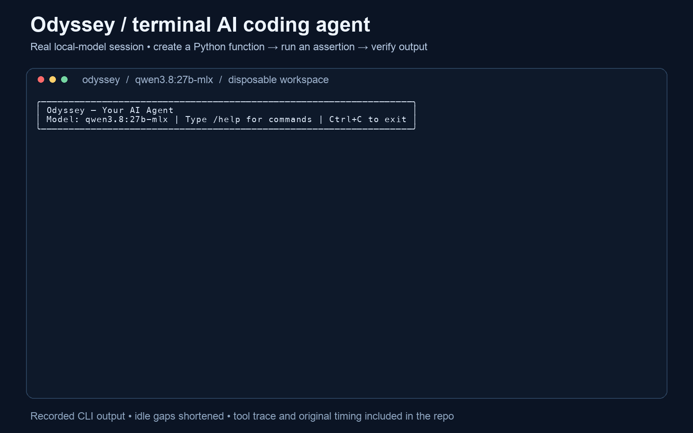
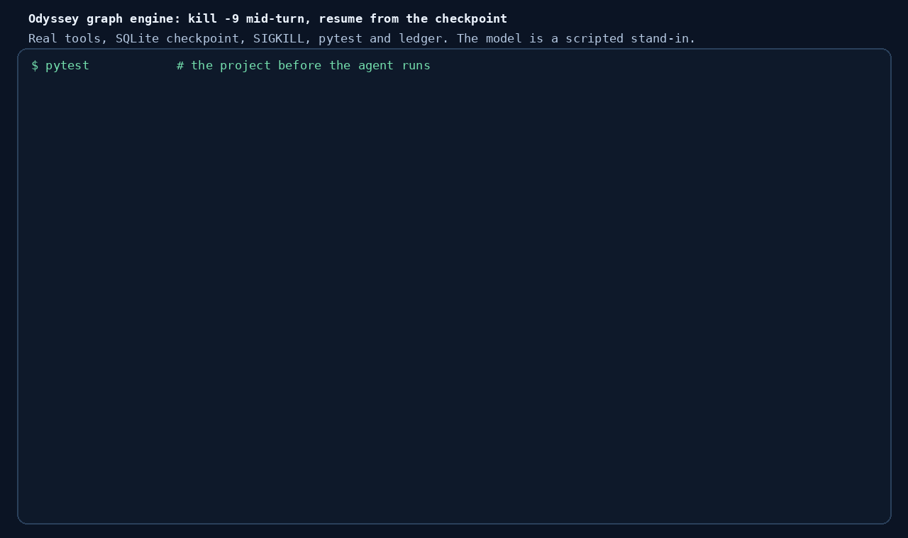

# Odyssey — Versatile AI Agent for Your Terminal

A local-first AI agent that runs in your terminal. Uses a configurable Ollama endpoint for model inference, with local SQLite and ChromaDB persistence and tools for coding, web research, tasks and memory.

## Recorded demo



A genuine CLI session using local `qwen3.8:27b-mlx`: the agent writes `greet.py`,
runs a Python assertion through its `bash` tool, and receives
`PASS: greeting verified`. Recorded from commit `c0137fa` on 2 November 2026 in a
disposable workspace. Idle gaps are shortened and viewing holds are added; this
is a functional demonstration, not a latency benchmark.

[Video (MP4)](docs/demo/odyssey-demo.mp4) ·
[Original terminal recording](docs/demo/session.cast) ·
[Saved tool results](docs/demo/tool-trace.jsonl) ·
[Recording details](docs/demo/README.md)

## Crash recovery (graph engine)



The graph engine checkpoints every step to SQLite. In this run the agent reads and edits `calc.py`, the process is killed with `kill -9` before the turn ends, and a new process resumes from the same checkpoint file: the two finished tool calls are not repeated, and the turn only counts as `verified` once the ledger gate has run the tests and they pass. The tools, the SQLite checkpoint, the SIGKILL, pytest and the ledger are real; **the model is a scripted stand-in**, so this shows the engine, not model ability. For a real model result see [Evaluation](#evaluation-experimental).

Reproduce it with `uv sync --extra verify && uv run python docs/demo/crash_resume.py` (the captured output is [`crash-resume.txt`](docs/demo/crash-resume.txt); `tests/test_verify_gate.py` runs the script in CI). Limits: file changes made before a crash stay on disk (there is no rollback), and a tool that was running at the moment of the crash may have run, which the resume reports instead of hiding.

## Features

- **Interactive REPL** — `uv run odyssey` drops you into a continuous `> ` prompt. Chat back and forth, the AI uses tools autonomously.
- **17 tools** — File operations, bash, search, web research, memory, task management, journaling, sub-agents.
- **Local model inference by default** — The default Ollama endpoint is localhost. Web search and URL-reading tools send requests to external sites; a remote Ollama endpoint receives the conversation (including tool results such as file contents, shell output, fetched pages and retrieved memories) and memory text or queries sent for embedding. This is not an offline or no-egress guarantee.
- **Autonomous tool loop** — The LLM decides which tools to call and in what order to fulfill your request.
- **Coding + Daily life** — Read/edit files, run commands, grep/glob codebases, search the web, save memories, manage tasks, journal.

## Architecture

```
$ uv run odyssey
  │
  ▼  REPL (prompt_toolkit)
  │  > "research quantum computing and save to report.md"
  │
  ▼  Tool-Calling Loop
  │  LLM → tool_call → execute → result → LLM → tool_call → ... → done
  │
  ┌────────┬────────┬────────┬────────┬────────┬────────┐
  │ bash   │ read   │ write  │ edit   │ glob   │ grep   │
  ├────────┼────────┼────────┼────────┼────────┼────────┤
  │ web_   │ read_  │ save_  │ query_ │ add_   │ save_  │
  │ search │ url    │ memory │ memory │ task   │ journal│
  └────────┴────────┴────────┴────────┴────────┴────────┘
  │
  ▼  Ollama (local LLM)
     fast_model / deep_model from the loaded configuration
```

## Tools

| Tool | What it does |
|---|---|
| `bash` | Run shell commands (git, build, test, scripts) |
| `read` | Read file contents with line numbers |
| `write` | Create or overwrite files |
| `edit` | Exact-string replacement editing |
| `glob` | Find files by pattern (`**/*.py`) |
| `grep` | Regex content search via ripgrep |
| `web_search` | Search the web via DuckDuckGo |
| `read_url` | Fetch and extract content from a URL |
| `save_memory` | Save to long-term vector memory |
| `query_memory` | Semantic search over saved memories |
| `add_task` / `list_tasks` / `complete_task` | Persistent task management |
| `save_journal` / `get_journal_summary` | Journal with AI sentiment analysis |
| `todo_write` | Track multi-step progress |
| `task` | Spawn sub-agents for parallel work |

## What the agent can and cannot do today

- **Workspace boundary.** In the REPL the `read`, `write`, `edit`, `glob` and `grep` tools are confined to the project root (the nearest parent with a `.git` directory, otherwise the launch directory). Paths outside it, including symlinks that point outside, are refused. Set `ODYSSEY_ALLOW_OUTSIDE_WORKSPACE=1` to lift this. **`bash` is not sandboxed and is not covered by the boundary**; it starts in the launch directory and can reach anything your user can.
- **Tool-call ids.** Every tool call gets an id, and its result is stored with that id and the tool name. Executed calls are also kept in `Conversation.tool_log` with arguments, result and duration.
- **No resume in the default loop.** The conversation lives in memory. `/save` writes a jsonl copy for reading. Use `--engine graph` for resumable runs.
- **No acceptance check by default.** A task ends when the model answers without calling a tool. Nothing runs the tests for it.
- **`todo_write` is a text echo in the default loop.** The graph engine keeps a real plan.
- **Sub-agents are sequential.** `task` runs the same loop again in a fresh conversation, with the same tools and shell; it has no separate workspace or permissions.
- **The default loop does not use `langgraph`.** Only the opt-in graph engine does.

## Graph engine (experimental): resumable runs with approvals

`odyssey --engine graph` runs the same tools on a LangGraph state machine instead of the hand-written loop. The default is still the loop; use the graph engine to try it.

```
agent -> gate -> approve -> tools -> (tools | agent)
agent -> verify -> (agent | end)
```

- **Approvals.** `bash`, `write` and `edit` pause the run and wait. `/approve` runs the call (`/approve always` stops asking for that tool in this session), `/reject [reason]` refuses it and tells the model why. `--yes` disables the prompts. Read-only tools, memory, tasks and web tools run without asking.
- **Checkpoints and resume.** After every step the graph state is saved to a SQLite file in the data directory (`checkpoints.sqlite`), with synchronous durability. If the process is killed, `odyssey --engine graph --resume` continues the last thread started from the same directory (Odyssey keeps one per launch directory and refuses to run a thread from another directory) and `/resume` finishes the interrupted turn. A test kills a real process mid-turn and resumes it.
- **What resume does not do.** A tool call that was running when the process died has no recorded result and runs again; Odyssey tells you which call it was. Checkpoints save the conversation state, not your files, so a half-applied edit stays applied.
- **Plan.** `todo_write` now stores a structured plan in the graph state (`/plan` shows it) and the plan is given to the model on every step.
- **Budgets.** Per turn, at most 25 model calls and 40 tool calls; the run stops with `budget_exhausted` instead of looping.
- **Completion gate (optional).** `odyssey --engine graph --verify "pytest -q"` (install with `pip install 'odyssey[verify]'`) makes "done" a claim that has to pass a command. When the model answers after a turn that used `bash`, `write`, `edit` or `task` (a sub-agent's own calls are not in the log, so delegating counts as a possible change), the gate records a `task_complete` claim in a [transactional-agent-ledger](https://github.com/RockENZO/transactional-agent-ledger) database (`ledger.sqlite` in the data directory), with that turn's tool-call ids as provenance, runs the command in the project root, and marks the claim committed or rejected with the command's output. A failure goes back to the model for up to two repair rounds; if it still fails the turn ends `unverified`, every attempt stays in the ledger, and the REPL shows the output. Turns that only read are not checked. `build_graph(..., acceptance=...)` takes any async check, and `engine.verify.ledger_gate(argv, ledger_path=..., extra=...)` accepts another ledger verifier, for example one that pins the test files.
- **What the gate does not do.** The command is not sandboxed. It checks only what the command checks: an agent that can edit the tests can make them pass unless you pin them. A failed check does not roll the project back: the ledger's `run_step` can snapshot and restore a workspace, but it copies the whole directory, which is not safe to do to a real repository on every turn.
- **Cassettes (optional).** `/cassette [path]` saves the thread's executed tool calls (name, arguments, the text the tool returned, and the call id) as a [trajectory-replay](https://github.com/RockENZO/trajectory-replay) cassette (`pip install 'odyssey[eval]'`). Calls you rejected were never run and are left out. With a cassette you can replay a run without a live model and score a new run's trajectory against it; `tests/test_cassette_export.py` replays a recorded run through the engine and shows a diverging run being caught. The cassette keeps the tool's text, not whether it succeeded, so a replayed failure is judged by its text.
- **Sub-agents under approval.** A `task` sub-agent runs inside one graph step and cannot pause to ask, so tools that need approval (`bash`, `write`, `edit`) are refused there and the sub-agent is told to hand the step back. With `--yes`, or after `/approve always` for a tool, the sub-agent may use it.
- **Not covered.** Sub-agents (`task`) still use the old loop inside the graph's `tools` step, not their own subgraph. The wall-clock time budget is not implemented. Not yet tried against a live Ollama model.

## Evaluation (experimental)

`odyssey.evals` is a frozen suite of ten small Python tasks (fix an off-by-one, implement a function from its docstring, rename across files, and so on) and a runner that measures the graph engine on it. Each task is a tiny project whose tests fail at the start. Install with `pip install 'odyssey[verify,eval]'` (this includes pytest, which runs the checks).

```
python -m odyssey.evals --out results/run-1                 # live model through Ollama (the configured fast model, or --model NAME)
python -m odyssey.evals --out results/oracle --oracle       # scripted reference solution: not a model result
python -m odyssey.evals --out results/lazy --lazy           # scripted do-nothing model: the checks must fail
```

- **Tools.** An evaluated model runs unattended with approvals off, so it gets only `read`, `write`, `edit`, `glob`, `grep` and `todo_write`: no shell, no web, and none of the tools that write to your own memory, journal or task list. File tools stay inside the task directory. The gate runs the tests and gives failures back, so the model does not need a shell to iterate. `--allow-bash` adds the shell back; it is not sandboxed. The report lists the tools offered.
- **How a task is judged.** The agent works in a fresh directory with no approval prompts. When it finishes, the runner runs the project's tests itself, with the test files pinned to their original text, so editing a test to make it pass fails. The check ignores anything the agent could plant in the directory (`conftest.py`, `pytest.ini`) and requires the exact number of test cases to run and pass, so skipping the tests does not count. That independent check is the result. The gate's own verdict is recorded next to it; the two can differ, and the report counts the disagreements.
- **Frozen.** `suite_hash()` covers every prompt and file, and a test compares it with the recorded `SUITE_HASH`. Changing a task means bumping `SUITE_VERSION` and `SUITE_HASH` together and not comparing results across versions.
- **What it writes.** `report.json`, `report.md` (device, model and digest when Ollama reports one, package versions, suite hash, one row per task), a cassette per task in `cassettes/`, and the ledger of every check in `ledger.sqlite`. Trajectory F1 against the reference solution (tool name and target path, not file text) is included as a diagnostic: a coding task has many valid trajectories.
- **Checked without a model.** The reference solution passes all ten tasks and a do-nothing model fails all ten (tests in `tests/test_evals.py`), so each task is solvable and each check is real. Those two runs are labelled "not a model result" in their reports.
- **A known gap.** The gate does not check a turn that changed nothing, so a model that says "it looks fine" without touching the files is reported `verified` by the gate. The independent check still fails it, which is why the report keeps both columns.
- **Limits.** Ten short single-language tasks say little about large codebases, other languages or vague requests. Runs use temperature 0, which is not bit-exact on every backend.

### Results

| Model | Device | Passed | Date |
| --- | --- | --- | --- |
| `qwen3.8:27b-mlx` (Ollama 0.40.13, id `5642e97495e1`, nvfp4) | Apple-silicon Mac (Darwin arm64), Python 3.13 | 10 of 10 (independent check) | 2026-11-03 |

One run, suite version 1 (hash `2419f570a45a`), tools `read, write, edit, glob, grep, todo_write`, no bash. The gate and the independent check agreed on all ten tasks, no task needed a repair, and the run took 485 s in total (median 7.5 tool calls per task). This shows that the pipeline runs end to end with a real local model and produces checkable verdicts; it is not a measure of the model's coding ability. The tasks are ten short single-file problems, there was a single run, and temperature 0 is not bit-exact. The trajectory column of that run's report compared whole file contents and read 0.00 for every task, which says nothing; the comparison now uses the tool and target path.

## Quick Start

### Prerequisites

- Python 3.13+
- [Ollama](https://ollama.ai) running locally
- Installed chat models supporting tool calls, selected explicitly in the configuration. Memory tools also require an embedding model compatible with Ollama’s embed API. The code currently defaults all three model fields to `qwen3.6:35b-a3b-coding-nvfp4`; availability and embedding support must be checked on your installation.

### Install & Run

```bash
git clone https://github.com/RockENZO/odyssey.git
cd odyssey
# Sync the project environment:
uv sync
uv run odyssey

# Or install globally so you can run `odyssey` from anywhere
uv tool install --force .
odyssey
```

This drops you into the REPL. Try:

```
> read the README and summarize it
> list all .py files in this project
> search the web for "local AI agents"
```

### Commands in the REPL

| Command | What it does |
|---|---|
| `/exit` or `/quit` | Exit Odyssey |
| `/help` | Show available commands |
| `/clear` | Clear conversation history |
| `/model` | Show current LLM model |
| `/status` | Check Ollama connection |
| `/history` | Show recent conversation |
| `/save` | Save session to file |
| `!command` | Run directly in shell (passthrough) |

### Configuration

The default configuration directory comes from `platformdirs` and differs by operating system; it is not universally `~/.config/odyssey`. Print it with:

```bash
# From the checkout:
uv run odyssey config-path
# After global installation, from any directory:
odyssey config-path
```

Create `config.toml` in that directory. Alternatively, set `ODYSSEY_CONFIG_DIR` to a chosen directory before launching. `ODYSSEY_DATA_DIR` overrides local persistence. Both overrides expand `~` and create missing parent directories automatically; an existing file or inaccessible directory raises an error without overwriting it. The `config-path` command creates the configuration directory but does not start the agent or contact Ollama. Use the exact installed model names; the following shows the checked-in defaults, not validated recommendations:

```toml
ollama_host = "http://localhost:11434"
fast_model = "qwen3.6:35b-a3b-coding-nvfp4"
deep_model = "qwen3.6:35b-a3b-coding-nvfp4"
embedding_model = "qwen3.6:35b-a3b-coding-nvfp4"
```

## How It Works

Odyssey is an **interactive CLI tool, not a background daemon**. Each `uv run odyssey` session:

1. Starts the REPL and waits for your input
2. For each message, runs the **tool-calling loop**: the LLM receives your request + tool schemas, decides which tool to call, executes it, gets the result, and repeats until it can answer
3. Returns to the `> ` prompt for your next message
4. When you `/exit`, the CLI process ends; persisted files remain and Ollama may continue running

The only persistent background process is **Ollama** itself (`ollama serve`), which keeps the LLM model loaded in memory.

## Project Structure

```
src/odyssey/
├── cli/           # REPL entry point (prompt_toolkit)
├── core/          # Tool-calling loop, conversation state, tool-call ids, workspace boundary
├── engine/        # LangGraph engine: graph, approval policy, plan, checkpointed sessions, ledger completion gate
├── tools/         # 17 tool implementations
│   ├── bash.py          # shell execution
│   ├── file_ops.py      # read, write, edit
│   ├── search_tools.py  # glob, grep
│   ├── web.py           # web_search, read_url
│   ├── memory.py        # save/query memory
│   ├── task_manager.py  # task CRUD
│   ├── journal_tools.py # journal + sentiment
│   ├── sub_agent.py     # task sub-agent
│   └── registry.py      # tool registration
├── llm/           # Ollama async client
├── storage/       # SQLite + ChromaDB persistence
└── config.py      # settings
```

## Tech Stack

| Component | Choice |
|---|---|
| Agent architecture | Tool-calling loop (LLM chooses tools) |
| Model inference | Configurable Ollama chat and embedding model names |
| Vector store | ChromaDB |
| Structured storage | SQLite |
| REPL UI | prompt_toolkit |
| CLI rendering | Rich |
| Web search | DuckDuckGo |


## Startup and persistence regression tests

These isolated tests exercise real SQLite persistence, first-run directories, the installed CLI,
the workspace boundary and the tool loop (driven by a scripted fake model) without downloading a
model or contacting Ollama. CI installs the full locked environment and runs the whole suite:

```bash
uv sync --group dev
uv run pytest -q
```

### Shell command lifecycle

On macOS and Linux, each `bash` tool call runs in its own process session.
Timeout or task cancellation kills that process group and reaps the direct
process before releasing the command lock. Reaping has a two-second cleanup
budget; an OS-level failure to reap is reported explicitly. Repeated cancellation
cannot interrupt cleanup. Process creation has no async cancellation gap. Cancelling propagates to the caller rather
than returning a success message. Output uses the active locale encoding and retains normal exit-code reporting.
Output is spooled to temporary files so inherited output handles in an escaped
session cannot hold cleanup open; the 30,000-character display cap is not a disk
usage quota. Only the first 120 KB of each captured stream (four bytes per
character of the display cap) is read back and decoded, so a command that writes
gigabytes of output is truncated without loading the whole file into memory; the
temporary files can still consume disk until the command exits or times out.
Processes that deliberately create another session can escape this
group; this is lifecycle cleanup, not a security sandbox. On non-POSIX systems,
cleanup can terminate only the direct process. Tools run with the current user's
file and shell permissions; use a disposable environment for untrusted tasks.

`web_search`'s HTML fallback and `read_url` stream remote bodies instead of
reading them whole: at most 512 KB for the fallback and 2 MB for `read_url`
before HTML cleaning and the 8,000-character visible-text cap. A larger response
is closed early and reported as truncated. Neither tool validates the URL, so
loopback, private-network and metadata-service URLs are reachable from a tool
call; run untrusted content with that in mind.
